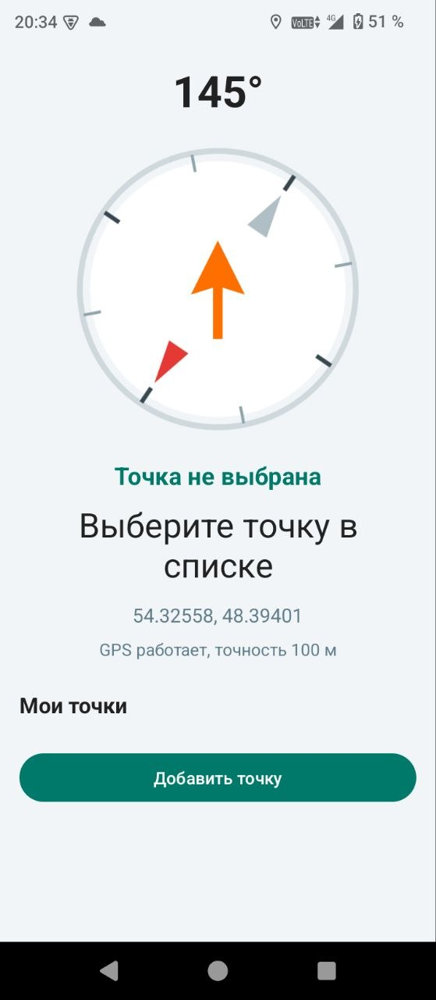
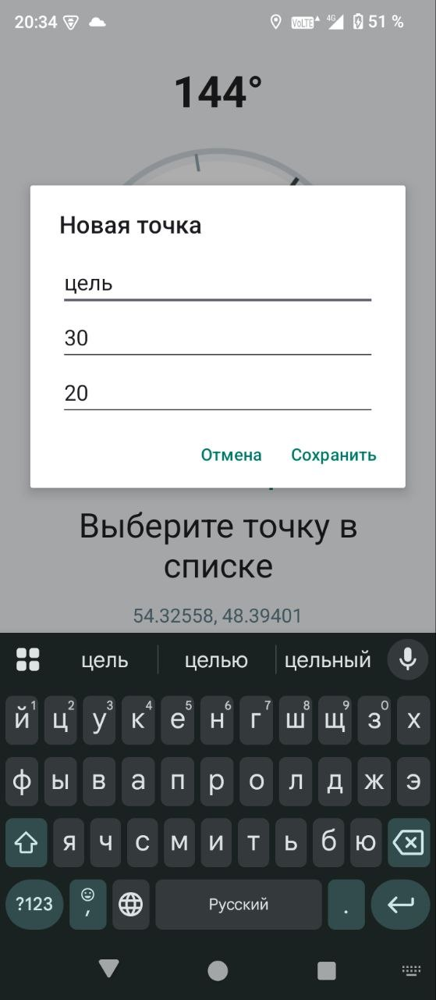
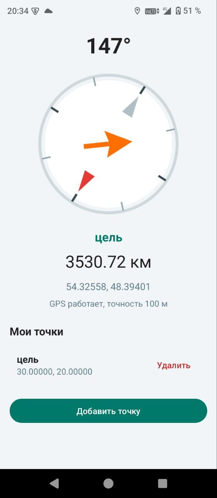
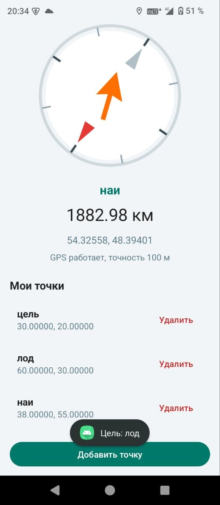

# Компас и офлайн-навигатор по точкам (GPS)

Android-приложение, которое показывает направление и расстояние до сохранённых точек. Работает без интернета и без карт.

## Функции

- Компас с направлением в градусах
- Сохранение точек по названию и координатам
- Выбор точки как цели и стрелка на неё
- Расчёт расстояния до цели
- Список точек с удалением
- Работа офлайн (нужен только GPS)

## Установка

1. Открой страницу [Releases](https://github.com/KINGBACZ/compass-gps-navigator/releases).
2. Скачай файл `compass-navigator.apk`.
3. Открой файл на телефоне. Если система попросит, разреши установку из неизвестных источников.
4. Запусти приложение и разреши доступ к местоположению.
5. Для точных данных включи на телефоне геолокацию в режиме «Высокая точность» и выйди на улицу.

## Требования

- Android 7.0 (API 24) и выше
- Датчик GPS и компас в телефоне

## Технологии

- Kotlin
- Android SDK
- SensorManager (компас)
- LocationManager (GPS)
- SharedPreferences (хранение точек)
- ViewBinding, Material Design

## Скриншоты

| Главный экран | Добавление точки |
|---|---|
|  |  |

| Навигация к цели | Список точек |
|---|---|
|  |  |